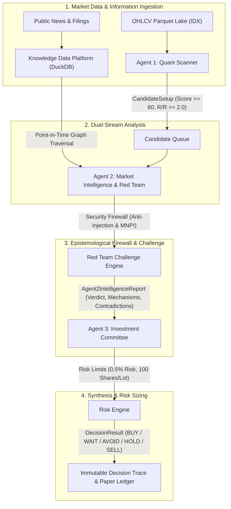

# SwingDeck — AI-Powered Quantitative Swing Trading Desk

[](https://www.python.org/)
[](https://duckdb.org/)
[](knowledge/agent/AGENT_ARCHITECTURE.md)
[](LICENSE)
[](knowledge/canonical/GOVERNANCE.md)
[](CONTRIBUTING.md)

**SwingDeck** adalah platform riset kuantitatif dan simulasi *trading desk* berbasis **3 AI Agent kolaboratif** untuk pasar saham Indonesia (IDX / BEI). Sistem ini dirancang untuk mengidentifikasi peluang *swing trading* dengan *positive expected value* (EV) melalui disiplin eksekusi kuantitatif, analisis konteks relasional berbasis *knowledge graph*, pengujian kontradiksi (*Red Team*), dan mitigasi risiko ketat (*fail-closed risk management*).

---

## ⏱️ Ringkasan 1 Menit (Onboarding Quick Summary)

> **SwingDeck** beroperasi seperti tim *investment desk* institusional modern: **Agent 1 (Quant)** bertindak sebagai scanner teknikal yang menyaring ribuan saham menjadi kandidat momentum berlikuiditas tinggi ($\ge \text{1 Miliar IDR}$); **Agent 2 (Market Intelligence & Red Team)** menantang setiap kandidat menggunakan basis data relasi entitas (*Knowledge Graph* DuckDB) dan berita *Point-in-Time* untuk mendeteksi paparan risiko dan kontradiksi tersembunyi; dan **Agent 3 (Investment Committee & Risk Engine)** menyintesis seluruh bukti menjadi keputusan akhir (`BUY`, `WAIT`, `HOLD`, `SELL`, `AVOID`, `INSUFFICIENT`) lengkap dengan ukuran lot bulat statutory (100 lembar/lot) dan batas risiko maksimal 0.5% per transaksi.
>
> Seluruh sistem beroperasi dalam lingkungan **simulasi lokal (paper trading only)** dengan perlindungan *Point-in-Time (PIT)* yang ketat agar tidak terjadi kebocoran masa depan (*lookahead bias*). Proyek ini memegang teguh prinsip **Anti-Halusinasi** (fakta tanpa bukti berstatus `UNKNOWN`) dan **Aksioma Non-Kausalitas** ($\text{PRE\_DECISION\_EVIDENCE} \neq \text{POST\_DECISION\_OUTCOME}$), menjadikannya fondasi riset yang kokoh, transparan, dan dapat direproduksi secara deterministik.

---

## 🏛️ Arsitektur Tiga Agen (The Three Agents Pipeline)

Sistem beroperasi dengan **TEPAT 3 RUNTIME AGENTS** (`AGENT_4 = FORBIDDEN`):



### 1. Agent 1 — Quant & Market Scanner (*"Apa yang bergerak hari ini?"*)
- **Fokus**: Price action, filter tren (EMA 20/50/200), indikator momentum (RSI, MACD), profil volume (OBV, MFI), likuiditas harian ($\ge \text{1 Miliar IDR}$), harga nominal ($\ge \text{100 IDR}$), dan kekuatan relatif terhadap IHSG.
- **Output**: `CandidateSetup` terurut berdasarkan skor deterministik ($0 - 100$).

### 2. Agent 2 — Market Intelligence & Red Team (*"Mengapa bergerak dan apakah tesisnya tahan uji?"*)
- **Fokus**: Penelusuran relasi *Point-in-Time* (PIT) pada DuckDB, resolusi entitas, pemetaan transmisi eksposur (*direct, supplier, customer, macro*), deteksi kontradiksi, dan pengujian *Red Team*.
- **Guardrails**: Dilengkapi *Prompt Injection Firewall* dan *MNPI & Access Class Firewall* untuk mencegah informasi internal/ilegal masuk ke jalur keputusan.

### 3. Agent 3 — Investment Committee & Risk Engine (*"Haruskah kita bertindak sekarang dan bagaimana mengelola risiko?"*)
- **Fokus**: Sintesis multi-dimensi sinyal teknikal dan laporan intelijen, pembulatan lot statutory BEI (kelipatan 100 lembar), batas risiko modal (maks. 0.5% ekuitas), validasi $R:R \ge 2.0$, dan pencatatan *immutable decision trace*.
- **Output**: Tindakan terarah (`BUY`, `WAIT`, `HOLD`, `SELL`, `AVOID`, `INSUFFICIENT`) dengan prinsip *fail-closed*.

---

## 🗄️ Fondasi Data (Knowledge Data Platform)

SwingDeck menggunakan arsitektur dual-storage yang efisien dan deterministik:
- **DuckDB (`data/duckdb/intelligence.duckdb`)**: Menyimpan graf relasi entitas (`dim_entity`, `fact_relationship`, `fact_exposure`), kejadian informasi (`fact_information_event`), hipotesis mekanisme, dan *link* reaksi pasar dengan jaminan isolasi waktu *Point-in-Time* (`valid_from <= AS_OF`).
- **Parquet Lakes (`data/parquet/`)**: Menyimpan data time-series historis OHLCV per saham IDX untuk komputasi kuantitatif berkecepatan tinggi.

---

## 🚀 Panduan Memulai Cepat (Quickstart & Setup)

### 1. Prasyarat Sistem
- **Python**: Versi `3.12+` (Disarankan Python 3.12.x).
- **OS**: Windows, macOS, atau Linux.
- **Git**: Versi 2.30+.

### 2. Instalasi
```bash
# 1. Clone repositori
git clone https://github.com/BBB30011/swingdecks.git
cd swingdecks

# 2. Buat virtual environment
python -m venv .venv

# 3. Aktifkan virtual environment
# Pada Windows PowerShell:
.venv\Scripts\Activate.ps1
# Pada Linux / macOS:
source .venv/bin/activate

# 4. Instal seluruh dependensi resmi
pip install -r requirements.txt
```

### 3. Menjalankan CLI Interaktif (SwingDeck Shell)
```bash
python main.py
```
*Contoh perintah di dalam shell:*
```text
swingdeck> AGENT2 UPDATE NEWS BBCA RECENT --mode api
swingdeck> quit
```

### 4. Menjalankan Dashboard Monitoring
```bash
# Menjalankan Streamlit Dashboard
streamlit run dashboard/app.py

# Atau menjalankan Backend FastAPI
python -m uvicorn dashboard.backend.main:app --reload --port 8000
```

---

## 🧪 Validasi & Pengujian Sistem

Proyek ini memiliki suite pengujian komprehensif untuk memastikan kepatuhan arsitektur, determinisme, dan integritas data:

```bash
# 1. Uji Enforce Arsitektur (Memastikan tidak ada file liar di root)
pytest tests/test_00_architecture_enforcement.py -v

# 2. Uji Integrasi Alur Keputusan 3-Agent
pytest tests/test_intelligence_decision_integration.py -v

# 3. Uji Keseluruhan Test Suite Operasional (260+ tests, 100% Pass)
pytest -m operational

# 4. Pemindaian Semantic & Evidence Truth Gate (0 Findings)
python scripts/run_truth_gate.py
```

---

## 🛡️ Aturan Main & Batasan Sistem (System Guardrails)

Untuk menjaga integritas riset dan keamanan sistem:

| Parameter | Status | Keterangan |
| :--- | :--- | :--- |
| **Jumlah Runtime Agent** | `EXACTLY_3_AGENTS` | Agent 1 (Quant), Agent 2 (Intel), Agent 3 (Risk). `AGENT_4 = FORBIDDEN`. |
| **Mode Eksekusi** | `PAPER_ONLY = TRUE` | Seluruh order disimulasikan secara lokal (`LIVE_EXECUTION = BLOCKED`). |
| **Cabang Riset Saintifik** | `CLOSED & IMMUTABLE` | Eksperimen historis `COBA_001`–`COBA_018` beku permanen. `COBA_019 = NONE`. |
| **Optimasi Strategi** | `BLOCKED` | Dilarang mengubah-ubah parameter untuk mencari signifikansi palsu (*p-hacking*). |
| **Aksioma Kausalitas** | `NOT_PROVEN` | Korelasi atau keterkaitan informasi bukan merupakan bukti hubungan kausal. |
| **Integritas Bukti** | `FAIL_CLOSED` | Data yang tidak dapat dibuktikan secara kanonikal berstatus `UNKNOWN`. |

---

## 📂 Struktur Repositori

```text
SwingDeck/
├── .github/            # GitHub Actions CI workflow, PR, dan Issue templates
├── agents/             # Logika runtime Agent 1, Agent 2, dan Agent 3
├── configs/            # Konfigurasi YAML (universe, risk, scanner, model)
├── core/               # Engine platform (Knowledge Data Platform, Risk Engine, Simulator)
├── dashboard/          # Visual UI Dashboard (Streamlit) & FastAPI Backend
├── data/               # DuckDB database dan Parquet market lakes
├── docs/               # Dokumentasi arsitektur data & entity models
├── gates/              # Rekaman bukti gate evaluasi saintifik yang telah ditutup
├── governance/         # Peta sistem, arsitektur, dan change control
├── knowledge/          # Basis pengetahuan, ontologi relasi, dan konstitusi agen
├── logs/               # Log telemetri dan riwayat eksekusi
├── positions/          # State buku besar posisi paper trading aktif
├── queue/              # Antrean komunikasi dan job dispatching antar-agen
├── reports/            # Laporan audit formal dan sertifikasi gate
├── research/           # Arsip riset eksperimen historis yang telah dibekukan
├── runtime/            # State mutable runtime trading desk
├── scratch/            # Ruang kerja temporer untuk skrip diagnostik
├── scripts/            # Skrip utilitas, pemeliharaan, truth gate, dan audit harness
├── state/              # Status persisten engine
├── tests/              # Test suite (Unit, Integration, Metamorphic, Operational)
├── .env.example        # Template konfigurasi variabel lingkungan lokal
├── .gitignore          # Aturan penyaringan file sensitif dan cache
├── CODE_OF_CONDUCT.md  # Pedoman perilaku komunitas & kontributor
├── CONTRIBUTING.md     # Panduan kontribusi, alur kerja Git, dan standar kode tim
├── LICENSE             # Lisensi resmi proyek (MIT License)
├── main.py             # CLI Interaktif utama
├── pytest.ini          # Konfigurasi runner Pytest
├── README.md           # Dokumentasi utama repositori ini
├── requirements.txt    # Daftar dependensi resmi proyek
└── SECURITY.md         # Kebijakan pelaporan kerentanan dan perlindungan rahasia
```

---

## 📚 Referensi & Dokumentasi Lengkap

- **Panduan Kontribusi & Tata Kelola**: [CONTRIBUTING.md](CONTRIBUTING.md)
- **Lisensi Proyek**: [LICENSE](LICENSE)
- **Pedoman Perilaku**: [CODE_OF_CONDUCT.md](CODE_OF_CONDUCT.md)
- **Kebijakan Keamanan**: [SECURITY.md](SECURITY.md)
- **Konstitusi & Batasan Agen**: [knowledge/agent/AGENT_ARCHITECTURE.md](knowledge/agent/AGENT_ARCHITECTURE.md)
- **Peta Epistemologi & Input-Output Agen**: [knowledge/agent/AGENT_KNOWLEDGE_MAP.md](knowledge/agent/AGENT_KNOWLEDGE_MAP.md)
- **Arsitektur Data Platform**: [docs/data/DATA_ARCHITECTURE.md](docs/data/DATA_ARCHITECTURE.md)
- **Skema Basis Data DuckDB**: [docs/data/DATABASE_SCHEMA.md](docs/data/DATABASE_SCHEMA.md)
- **Aturan Tata Kelola Saintifik**: [knowledge/canonical/GOVERNANCE.md](knowledge/canonical/GOVERNANCE.md)

---

*Disclaimer: SwingDeck adalah platform riset dan simulasi edukatif kuantitatif. Output yang dihasilkan sistem tidak dimaksudkan sebagai nasihat keuangan atau rekomendasi investasi riil.*
