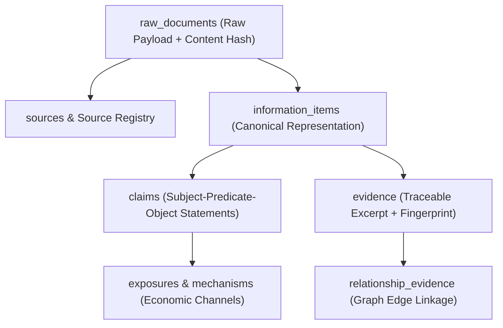

# SwingDeck Knowledge Data Platform — Information, Evidence & Lineage V1

## 1. Information and Claim Hierarchy

SwingDeck strictly separates raw documents, claims, evidence, and canonical information items:

## 2. Temporal & Access Control Rules

### 2.1 Point-in-Time (PIT) Invariance
Every query evaluated at decision timestamp $T_0$ must satisfy:
- $published\_at \le available\_at \le T_0$
- $valid\_from \le T_0 < valid\_to$ (or $valid\_to \text{ IS NULL}$)
- Future disclosures with $available\_at > T_0$ are completely masked.

### 2.2 Access Control Firewall
- `PUBLIC`: Decision-eligible if provenance and PIT checks pass.
- `AUTHORIZED_PRIVATE`: Internal analytical storage permitted; trading ineligible by default.
- `RESTRICTED`: Hard quarantine from trading decision pathways.
- `MNPI`: Material Non-Public Information $\rightarrow$ Hard block $\rightarrow$ Agent 3 forces `AVOID`.
- `UNKNOWN`: Quarantined.

### 2.3 Origin Classification
Every record is tagged with an immutable origin class:
- `NATURAL`
- `HISTORICAL`
- `FIXTURE`
- `SYNTHETIC`
- `FAILURE_INJECTION`
- `CONTROLLED`

A fixture or synthetic record can never be passed off as a natural observation.

## 3. End-to-End Traceability & Lineage

The system answers the 10 fundamental provenance questions for any decision-critical fact:
1. **Where did this come from?** $\rightarrow$ `sources.source_name` / `sources.domain`
2. **When did we receive it?** $\rightarrow$ `raw_documents.retrieved_at`
3. **When was it published?** $\rightarrow$ `information_items.published_at`
4. **Who published it?** $\rightarrow$ `sources.publisher`
5. **What was the original document?** $\rightarrow$ `raw_documents.source_document_id`
6. **What hash did it have?** $\rightarrow$ `evidence.content_hash` (SHA-256)
7. **Which claim did it support?** $\rightarrow$ `claims.claim_text`
8. **What entity does it refer to?** $\rightarrow$ `entities.canonical_name`
9. **What relationship did it create?** $\rightarrow$ `entity_relationships.relationship_type`
10. **What other evidence supports it?** $\rightarrow$ `DuplicateAndCorroborationEngine` independent sources.
