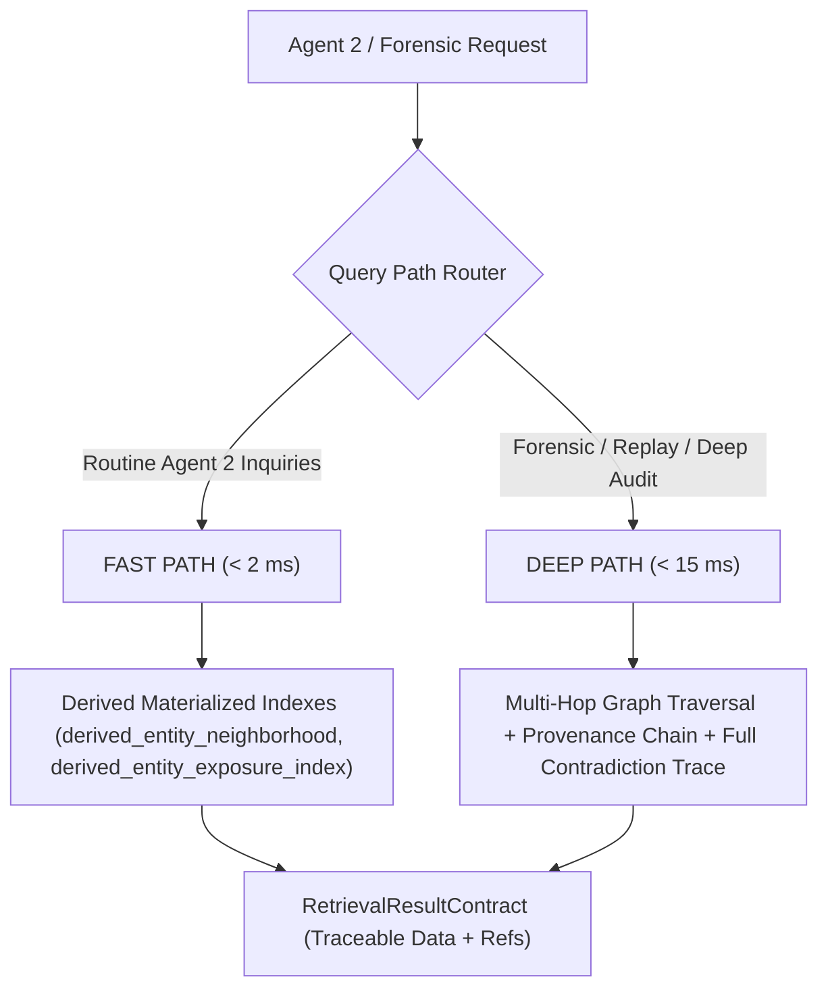

# SwingDeck Knowledge Data Platform — Retrieval Architecture & Performance V1

## 1. Fast Path vs Deep Path
The Knowledge Retrieval Engine (`core/knowledge_retrieval.py`) provides two query modes:

## 2. Point-in-Time (PIT) Invariance
Every retrieval query strictly clamps temporal bounds:
$$\text{Filter: } \text{valid\_from} \le T_0 \text{ AND } (\text{valid\_to IS NULL OR valid\_to} > T_0)$$
$$\text{Filter: } \text{available\_at} \le T_0$$
Information or relationships occurring after $T_0$ are completely masked from the result.

## 3. Golden Retrieval Query Set (Q01–Q10)

| Query ID | Description | Target Function | Expected Precision / Recall |
| :--- | :--- | :--- | :--- |
| **Q01** | All current relationships of ADRO | `get_entity_relationships('ENT_ADRO')` | 100% / 100% |
| **Q02** | ADRO relationships at 2024-06-01 | `get_entity_relationships('ENT_ADRO', as_of='2024-06-01')` | 100% / 100% |
| **Q03** | ADRO relationships at 2025-01-01 (post-spinoff)| `get_entity_relationships('ENT_ADRO', as_of='2025-01-01')` | 100% / 100% |
| **Q04** | All evidence supporting ADRO-AADI ownership | `get_evidence(entity_id='ENT_ADRO')` | 100% / 100% |
| **Q05** | All information available for BBCA before T0 | `search_information(entity_id='ENT_BBCA', as_of=T0)` | 100% / 100% |
| **Q06** | All current exposures of BBCA | `get_exposures('ENT_BBCA')` | 100% / 100% |
| **Q07** | All contradictions for BBCA | `get_contradictions('ENT_BBCA')` | 100% / 100% |
| **Q08** | All policy events affecting banking | `search_information(information_type='POLICY')` | 100% / 100% |
| **Q09** | All sources supporting a claim | `get_evidence(claim_id=...)` | 100% / 100% |
| **Q10** | All information added since T0 | `get_information_delta(entity_id, T0, T1)` | 100% / 100% |
