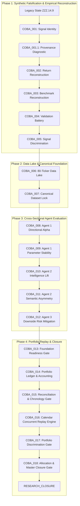

# MASTER COBA SERIES LINEAGE MAPPING

This document maps the complete scientific lineage of the COBA Series (**COBA_001 through COBA_018**) that systematically executed the empirical evaluation and ultimate closure of the frozen SwingDeck 3-agent research branch.

## 1. Master Lineage Architecture

## 2. Complete Historical Gate Directory

| Gate ID | Scientific Objective | Sample & Universe | Final Classification | Key Empirical Finding |
| :--- | :--- | :--- | :--- | :--- |
| **COBA_001** | Signal Identity & Inference | 250 Sessions, 12 Pilot Stocks | `DIAGNOSTIC` | Uncovered near-1.0 correlation across horizons. Disproved empirical validity of legacy synthetic returns. |
| **COBA_001.1** | Outcome Provenance Diagnostic | 12 Stocks | `DIAGNOSTIC` | Traced outcome generation to synthetic formula in legacy script. |
| **COBA_002** | Empirical Outcome Reconstruction | 12 Stocks, 2015–2026 | `FOUNDATION` | Successfully reconstructed true observed forward returns ($T+1$ to $T+20$) with zero synthetic scaling. |
| **COBA_003** | Empirical Peer-Excess Reconstruction | 12 Stocks | `FOUNDATION` | Isolated Leave-One-Out (LOO) peer mean definitions; rebuilt market benchmark empirically. |
| **COBA_004** | Signal Validation Battery | 12 Stocks, N=216 | `VALIDATION` | Cleared synthetic leakage but revealed severe coverage truncation due to strict signal filtering. |
| **COBA_005** | Empirical Signal Discrimination | 12 Stocks | `INCONCLUSIVE` | Date-clustered wild bootstrap proved highly sensitive to sample composition; mandated Data Lake expansion. |
| **COBA_006** | Data Lake Expansion | 80 Tickers, 2,826 Sessions | `DATA_LAKE_EXPANDED` | Constructed automated data lake ingesting 80 IDX equities across 11 years (2015–2026). |
| **COBA_007** | Master Canonical Dataset Lock | 80 Tickers, 1,760 Setups | `DATASET_LOCKED` | Cryptographically locked canonical setup matrix (1,760 setups, 828 ACT) across 4 market regimes. |
| **COBA_008** | Agent 1 Standalone Alpha Battery | 1,760 Setups, 80 Tickers | `NO_STANDALONE_ALPHA` | Unconditional forward directional returns statistically indistinguishable from control ($p > 0.40$). |
| **COBA_009** | Parameter Stability & Falsification | 1,760 Setups, Parameter Grid | `PARAMETER_UNSTABLE` | Momentum/breakout signal functions as candidate funnel, not predictive trigger; parameter shifts fail to induce alpha. |
| **COBA_010** | Agent 2 Incremental Intelligence Value | 1,760 Setups, DuckDB Ledger | `ZERO_INCREMENTAL_VALUE` | Contextual peer and fundamental evidence provided zero statistically reliable incremental directional lift over quant baselines. |
| **COBA_011** | Semantic Asymmetry & Contradiction | 1,760 Setups | `ASYMMETRY_UNSUPPORTED` | Specificity and contradiction flags did not separate winning from losing setups under PIT constraints. |
| **COBA_012** | Agent 3 Downside Risk Mitigation | 1,760 Setups (ACT vs REJECT) | `NO_RISK_FILTER_EVIDENCE` | Decision states showed no statistically reliable risk-filtering, downside mitigation, or MAE reduction capability. |
| **COBA_013** | Master Foundation Closure Gate | 1,760 Setups, Corporate Actions | `PORTFOLIO_READINESS_BLOCKED` | Audited corporate actions and cash tracking; blocked portfolio evaluation due to execution/ledger defects. |
| **COBA_014** | Master Historical Portfolio Ledger | 150 Setups, Multi-Year | `PORTFOLIO_ACCOUNTING_PARTIAL` | Built double-entry cash ledger, lot accounting, statutory fees, and dividend/split value conservation. |
| **COBA_015** | Portfolio Ledger Reconciliation Gate | 150 Setups, 2,826 Sessions | `LEDGER_VALIDATED_WITH_LIMITATIONS` | Validated low-level math (0.000000 IDR discrepancy); exposed isolated setup replay and same-day $H5$ shortcut limitations. |
| **COBA_016** | Calendar Concurrent Replay Engine | 1,760 Setups, 2,826 Sessions | `CONCURRENT_REPLAY_VALIDATED` | Constructed true calendar-stepped multi-day simulation with 5-position concurrency ceiling, dynamic cash ledger, and daily MTM. |
| **COBA_017** | Portfolio Discrimination Gate | 1,760 Setups, 105 Executed | `PORTFOLIO_SELECTION_SENSITIVE` | Identified severe candidate ordering sensitivity (equity spans 91.46M to 136.52M IDR) and 81.9% commodity sector clustering. |
| **COBA_018** | Allocation & Master Closure Gate | 1,760 Setups, 2,826 Sessions | `RESEARCH_CLOSURE` | 99.05% of executed trades concentrated in Energy/Mining; ordering fragility & sector-balanced collapse (-74%) confirmed. Scientific closure finalized. |

---

## 3. Permanent Freeze Mandate

No further COBA identifiers may be generated. All empirical results are permanently frozen and immutable.
