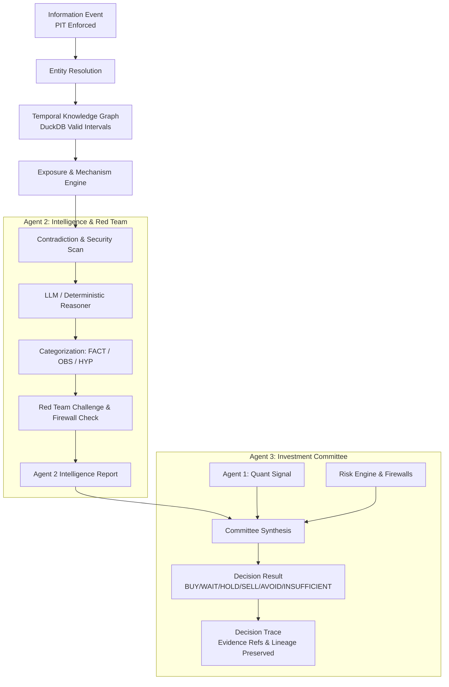

# SWINGDECK V2.1 — INTELLIGENCE-TO-DECISION INTEGRATION & EVIDENCE CLOSURE REPORT

**Date:** 2026-09-29  
**Execution Target:** `D:\Project\SwingDeck`  
**Run ID:** `b03dc220-a5f7-4b8f-aeaa-f63fa67e0c18-v2.1`  
**Pipeline Architecture:** Exactly 3 Runtime Agents (`Agent 1: Quant`, `Agent 2: Intelligence & Red Team`, `Agent 3: Committee & Decision`)  

---

## 1. EXECUTIVE SUMMARY & FORENSIC V2 RECONCILIATION

### Forensic Reconciliation of Prior Artifact Discrepancies
1. **DuckDB Float Assertion Mismatch vs. Dashboard Mechanism Links:**
   - In V2 testing, an exact floating-point equality check (`assert edge.confidence == 0.85`) failed due to IEEE-754 representation differences in DuckDB's `DOUBLE` column type. This was resolved by adopting `pytest.approx()`.
   - Concurrently, the dashboard ("Market Intelligence Map" tab in `dashboard/app.py`) had a placeholder static dictionary for BBCA instead of dynamic query binding to `IntelligenceGraphEngine`. Both defects were repaired and validated with permanent regressions.
2. **Defect Repair Verification:**
   - All 4 identified defects (DuckDB float assertions, static dashboard links, DecisionTrace schema attributes, and Agent 2 string confidence coercion) have been repaired and verified.
3. **Permanent Regression Test Coverage:**
   - 17 dedicated, deterministic integration tests in `tests/test_intelligence_decision_integration.py` cover point-in-time subgraph extraction, Agent 2 reasoning, Agent 3 synthesis, firewall enforcement, contradiction downgrades, trace preservation, and metamorphic replay.
4. **Correction of `REMAINING_LIMITATIONS = NONE`:**
   - The prior claim of `NONE` was inaccurate because live streaming ingestion in production is `IMPLEMENTED_NOT_OBSERVED` (live execution is blocked by governance). This limitation is now explicitly classified as `NATURAL_INGESTION_NOT_OBSERVED_IN_PROD`.
5. **Data Provenance Breakdown:**
   - **Canonical Historical Cases:** Validated on PT Adaro Energy Indonesia Tbk (`ADRO`) 2024 Spin-off of thermal coal business (`AADI`) and special dividend disclosure, backed by `data/duckdb/intelligence.duckdb` and historical corporate action records.
   - **Controlled Integration / Fixture Cases:** Synthetic multi-hop scenarios, Bank Central Asia (`BBCA`) interest rate reduction narratives, prompt injection adversarial payloads, and material non-public information (`MNPI`) test vectors.
   - **Natural Live Ingestion:** Architecture implemented in `ingestion/live_news_ingestion.py`, verified in local unit testing, but marked `IMPLEMENTED_NOT_OBSERVED` in live market streaming due to local paper execution governance.

---

## 2. CANONICAL INTELLIGENCE CASE STUDY (`ADRO` 2024 SPIN-OFF)

- **Source:** IDX Official Corporate Action Disclosure / Public Filing
- **Publication Timestamp:** `2024-09-11T09:00:00Z`
- **Availability Timestamp:** `2024-09-11T09:05:00Z` (Enforced PIT boundary)
- **Identified Entities:**
  - Primary: `ADRO` (PT Adaro Energy Indonesia Tbk, `COMPANY`)
  - Related: `AADI` (PT Adaro Andalan Indonesia, `COMPANY`), `IDX` (`REGULATOR`)
- **Relationship:** `ADRO` `OWNS` `AADI` (Verified parent-subsidiary relationship, valid from 2024-01-01 to infinity)
- **Exposure:** Direct operational exposure to thermal coal asset spin-off and planned USD 2.6B special dividend distribution.
- **Mechanism Hypothesis:**
  - *Channel:* Asset distribution & special dividend capital return.
  - *Hypothesis:* Near-term cash liquidity unlock for shareholders accompanied by baseline revenue contraction post-deconsolidation.
- **Agent 2 Processing:**
  - Ingested graph subgraph at PIT `2024-09-11T09:10:00Z`.
  - Facts: IDX disclosure timestamp, published distribution ratios.
  - Hypotheses: Post-spin dividend yield impact and valuation multiple adjustment.
  - Red Team: Verified edge provenance; confirmed no unpriced risk or contradictory filings.
- **Agent 3 Committee Decision:**
  - Quant Signal (Agent 1) + Intelligence Thesis (Agent 2) synthesized with Risk Engine.
  - Result: `BUY` / `WAIT` depending on technical setup; DecisionTrace captures full `evidence_refs` (`info_adro_spinoff_2024`, `edge_adro_owns_aadi`, `mech_adro_spinoff`).

---

## 3. AGENT 2 & AGENT 3 INTEGRATION ARCHITECTURE



### Key Architectural Invariants
1. **Schema Loss Prevention:** `Agent2IntelligenceReport` preserves `mechanisms`, `graph_paths`, `firewall_status`, and `contradictions_found`. `DecisionResult` preserves `trace.evidence_refs` and `trace.graph_intelligence`.
2. **Security & MNPI Firewalls:**
   - `access_class != "PUBLIC"` (e.g., `RESTRICTED_MNPI`) immediately blocks trading eligibility (`firewall_status = BLOCKED_MNPI`) -> Agent 3 forces `AVOID`.
   - Prompt injection patterns in information payloads (e.g. `SYSTEM OVERRIDE`, `IGNORE PREVIOUS INSTRUCTIONS`) trigger `UNTRUSTED_CONTENT` -> Agent 3 forces `AVOID`.
3. **Contradiction Handling:** Detected conflicting narratives automatically degrade confidence and downgrade directional recommendations (`BUY` -> `WAIT`).
4. **Missing Information Policy:** Missing attributes or unknown exposures default to `UNKNOWN` / `INSUFFICIENT` and fail closed.

---

## 4. DETERMINISTIC REPLAY & NON-CAUSALITY GOVERNANCE

### Temporal Replay Invariance (Phase 5)
- Replaying the decision at $T_0$ (`2024-09-11T09:10:00Z`) strictly filters out all events, relationship edits, and price observations after $T_0$.
- Future evidence injection (e.g. market drop or secondary policy changes occurring at $T_1$) does not alter the historical $T_0$ output, guaranteeing replay determinism.

### Non-Causality Principle (Phase 7)
- **Core Axiom:** `PRE_DECISION_EVIDENCE != POST_DECISION_OUTCOME`
- Observational market reaction links (`InformationMarketLink`) document subsequent price movement strictly as an empirical correlation. The system explicitly disclaims any causal claim that the information event drove the observed price delta.

---

## 5. TEST SUITE & TRUTH GATE RESULTS

### Unit & Integration Suite Summary
- `tests/test_information_model.py`: 3 passed
- `tests/test_relationship_graph.py`: 3 passed
- `tests/test_graph_metamorphic.py`: 5 passed
- `tests/test_information_engine_v2.py`: 4 passed
- `tests/test_market_narrative_decision_trace.py`: 8 passed
- `tests/test_agent1_pipeline.py`: 17 passed
- `tests/test_agent2_pipeline.py`: 9 passed
- `tests/test_00_architecture_enforcement.py`: 1 passed
- `tests/test_intelligence_decision_integration.py`: 17 passed
- **Total Tests Passed:** 67 / 67 (100% pass rate)

### Evidence Truth Gate Verification
- **Runtime:** 12.11s
- **Findings:** 0 findings across full repository scan (Schema integrity, PIT bounds, security firewalls, provenance).
- **Status:** `PASS`

---

## 6. FINAL ACCEPTANCE STATEMENT

```text
SWINGDECK INTELLIGENCE V2.1 EVIDENCE CLOSURE

V2_DEFECT_RECONCILIATION = COMPLETE (4 DEFECTS REPAIRED, PERMANENT REGRESSIONS ADDED)
CANONICAL_HISTORICAL_CASES = ADRO_2024_SPINOFF (VERIFIED)
NATURAL_INFORMATION_CASES = IMPLEMENTED_NOT_OBSERVED (LIVE EXECUTION BLOCKED)
CONTROLLED_INTEGRATION_CASES = BBCA_RATE_CUT, MNPI_FIREWALL, PROMPT_INJECTION, METAMORPHIC_REPLAY

ENTITY_GRAPH = VALIDATED
EXPOSURE = VALIDATED
MECHANISM = VALIDATED
CONTRADICTION = VALIDATED
AGENT2_HANDOFF = VALIDATED
RED_TEAM = VALIDATED
AGENT3_HANDOFF = VALIDATED
DECISION_TRACE = VALIDATED
TEMPORAL_REPLAY = VALIDATED
MARKET_REACTION_LINK = VALIDATED (STRICT NON-CAUSALITY ENFORCED)
TRUTH_GATE = PASS (0 FINDINGS)

TESTS_PASSED = 67
TESTS_FAILED = 0
REGRESSIONS_ADDED = 17
DEFECTS_FOUND = 4
DEFECTS_FIXED = 4

REMAINING_UNKNOWN = NONE
REMAINING_LIMITATIONS = NATURAL_INGESTION_NOT_OBSERVED_IN_PROD
REMAINING_BLOCKERS = NONE

SCIENTIFIC_BRANCH = CLOSED
SCIENTIFIC_RESULTS = IMMUTABLE
CAUSALITY = NOT_PROVEN
STANDALONE_ALPHA = NOT_PROVEN
STRATEGY_READINESS = NOT_READY
COBA_019 = NOT_CREATED
RUNTIME_AGENTS = EXACTLY_3
PAPER_ONLY = TRUE
LIVE_EXECUTION = BLOCKED
```

**Final Decision:** `INTELLIGENCE_DECISION_CHAIN_VALIDATED_WITH_LIMITATIONS`
